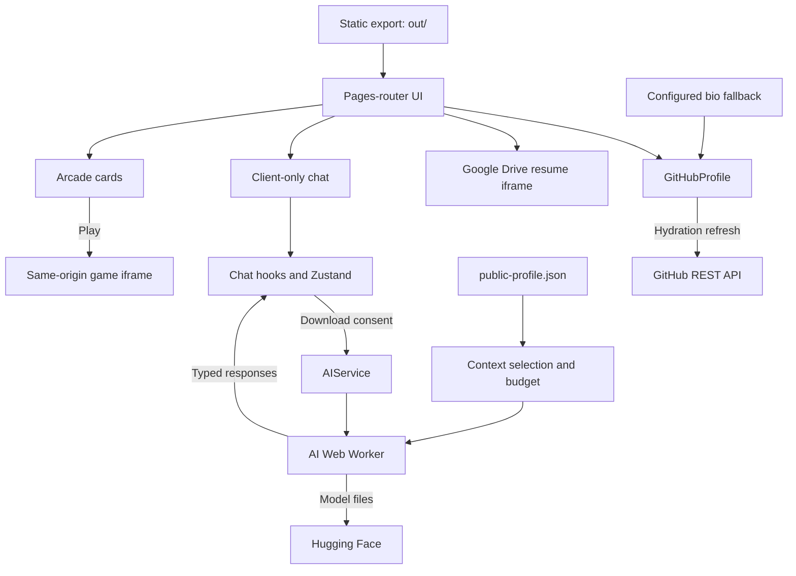
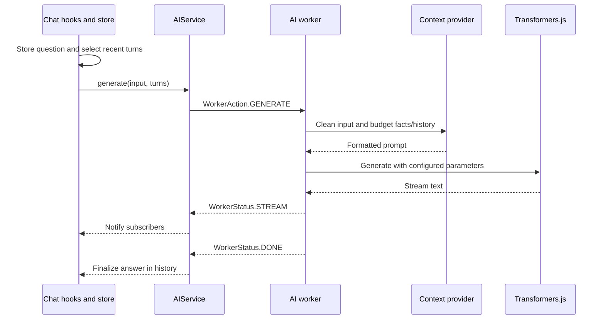
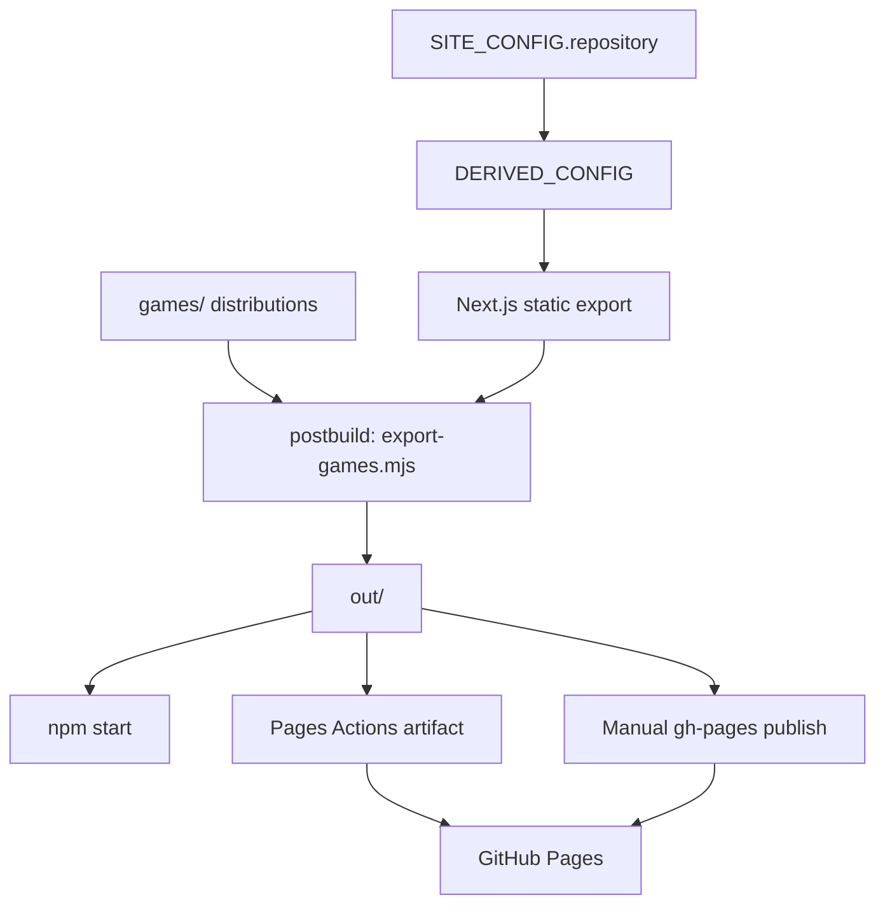
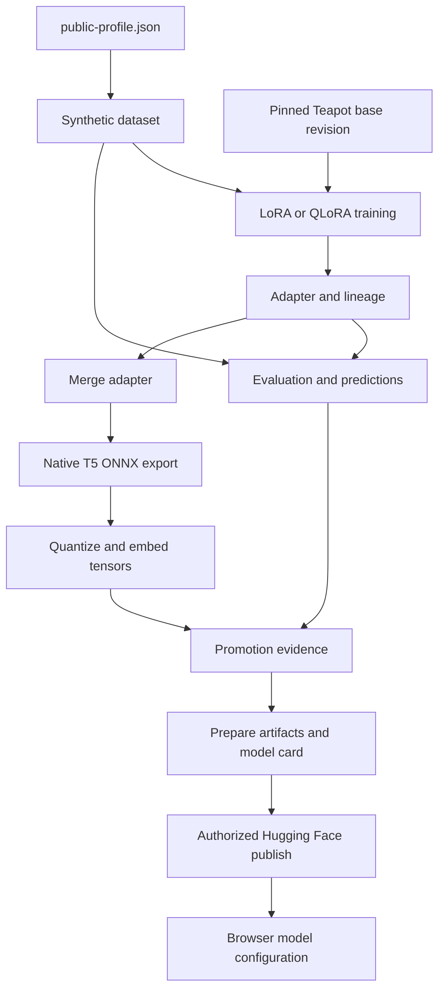

# Architecture and flows

The portfolio is a static website. Inference runs in the visitor's browser;
training and model publishing are separate local operations under `llm/`.
See [Customization](CUSTOMIZATION.md) for configuration fields.

## Website runtime

The profile renders its configured fallback until a successful hydration fetch.
Chat history lives in the in-memory Zustand store. Downloaded model files run
through Transformers.js in `src/services/ai/worker.ts`; there is no inference
server or browser-side training.

## Chat generation

Canonical facts and identity come from `src/config/public-profile.json`.
`models.ts` controls context/dtype settings; `prompts.ts` controls messages and
generation parameters. Automatic model loading tries `int8`, then `uint8`.

## Arcade boundary

| Owner | Responsibility |
| --- | --- |
| `src/config/arcade.ts` and `ArcadeGames.tsx` | Cards and selected game state |
| `GamePlayer.tsx` | Full-viewport dialog, iframe lifecycle, return focus |
| `GameControls.tsx` | Touch overlay and control rendering |
| `useGameControls.ts` | Input ownership, interruption cleanup, and overlay visibility |
| `gameFrame.ts` | Same-origin recipients, exact-document focus, and keyboard event delivery |
| `gameKeys.ts` | Shared keyboard definitions |
| `touchCapability.ts` | Session touch capability and subscriptions |
| Focused iframe | Native desktop keyboard input |
| `games/<game>/` | Game simulation and its declared static distribution |

Cards remain mounted behind the player. The bridge preserves typing protection,
key ownership, cancellation, and focus across loads. Website tests use inert
HTML/key recorders; they do not execute game source or prove gameplay fidelity.
See [website instructions](../src/AGENTS.md#input-bridge) for the input contract.

The host publishes overlay visibility on the iframe root as
`data-arcade-controls-visible="true"` or `"false"` and dispatches
`arcade-controls-visibility` on the child window with `{ visible: boolean }`
detail. Games can read the attribute at startup and listen for later changes;
the host republishes on iframe loads. The website's shared test fixture
intercepts every `/games/` URL with inert HTML by default; input tests override
it with key recorders.

## Static build and deployment

Production paths derive from the configured repository; user/organization site
repositories use the domain root. `trailingSlash: true` exports routes such as
`out/arcade/index.html`. Preview serves an existing build and infers its prefix.
Publishing requires authorization; building alone does not deploy.

## Local model pipeline

The pipeline binds evaluation to dataset, prompts, generation/scoring contracts,
model representation, and digests. Export verifies lineage; quantization binds
to the floating-point input; browser artifacts reject external tensor data.
Use [llm/AGENTS.md](../llm/AGENTS.md) for commands and the complete promotion gate.
