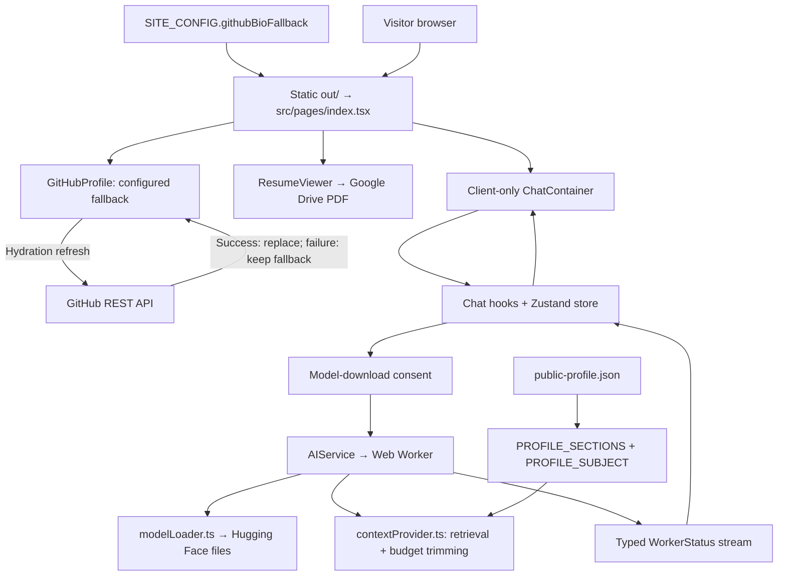
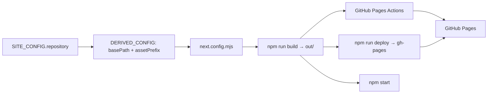
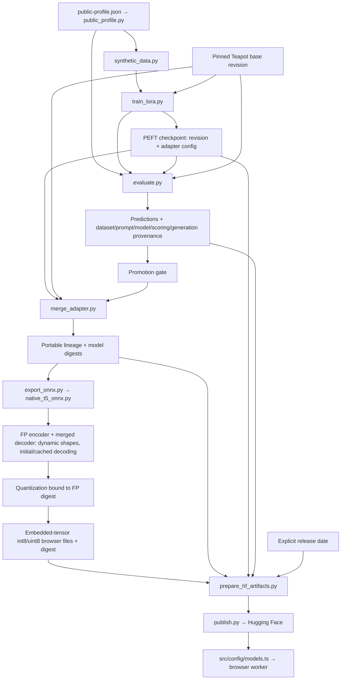

# Diagrams

System flows for the static portfolio, browser chatbot, and optional local
training pipeline. See [Customization](CUSTOMIZATION.md#configuration-map) for
configuration and the [pipeline guide](../ml/profile-qa/README.md) for commands.

## Application Runtime



Facts live only in `src/config/public-profile.json`; browser and Python consumers
load it directly. Prompts/generation use `src/config/prompts.ts`; model/dtype/
context settings use `src/config/models.ts` (`int8`, then `uint8`). Inference
stays in `src/services/ai/worker.ts`, off the main thread.

## Arcade Player

| Boundary | Responsibility |
| --- | --- |
| `src/config/arcade.ts` → `ArcadeGames.tsx` | Cards; Play selects a game without navigating |
| `GamePlayer.tsx` | Page-filling Radix dialog; creates iframe after Play; Back restores focus |
| `GameControls.tsx` → `useGameControls.ts` | Touch overlay, pointer-owned keys, same-origin iframe keyboard events |
| Native desktop keyboard → iframe | Focused game handles its keys |
| Game iframe → runtime | Exported browser build; Pokémon covers the DS opening through Tiny Woods and Caterpie's rescue |

Website tests substitute inert HTML to check loading, paths, focus, layout, and
input events. They never execute game source or establish gameplay fidelity.

## Chat Generation Flow

```mermaid
sequenceDiagram
  participant UI as Chat UI
  participant Store as Zustand
  participant Service as AIService
  participant Worker as AI worker
  participant Context as contextProvider
  participant Model as Transformers.js
  UI->>Store: Add user question
  UI->>Service: Generate with recent turns
  Service->>Worker: WorkerAction.GENERATE
  Worker->>Context: Clean input; select sections/history within budget
  Context-->>Worker: Formatted prompt
  Worker->>Model: Generate with configured params
  Model-->>Worker: Stream text
  Worker-->>Service: WorkerStatus.STREAM
  Service-->>Store: Update response
  Store-->>UI: Render answer
  Worker-->>Service: WorkerStatus.DONE
```

## Static Export and Base Path



- Production base path derives from `SITE_CONFIG.repository.name`; never
  hardcode repository or asset paths in components.
- Build before `npm start`; the preview infers the exported base path and
  redirects `/` to it.
- CI uses Pages Actions; manual deployment uses `gh-pages -d out`.
- No API routes, server actions, or server-side data loading.

## Fine-Tuning Pipeline



Train only when prompt/context edits are insufficient. The browser neither
trains nor calls an inference server.

| Stage | Guardrail |
| --- | --- |
| Configuration | `ml/profile-qa/profile_qa/config.py` holds model IDs, 1024-token budget and LoRA defaults |
| Dataset | Generated files stay under ignored `ml/profile-qa/data/` |
| Training | Fixed `teapotai/teapotllm` base; checkpoints retain the verified revision |
| Evaluation/packaging | Bind dataset, exact prompts, split, base/model digests, generation and scoring contracts; recompute metrics from predictions using one promoted model representation |
| Export | Native `torch.export` T5 path verifies lineage and content; quantization binds to its FP input; reject all external tensor data, regardless of sidecar name |
| App promotion | Pass the [promotion gate](../ml/profile-qa/README.md#promotion-gate) before changing `MODEL_ID`; keep `MODEL_CONTEXT_LIMIT` accurate |

Update the affected diagram when flow changes. Keep this file diagram-first;
put exact commands and detailed safeguards in the pipeline guide.
